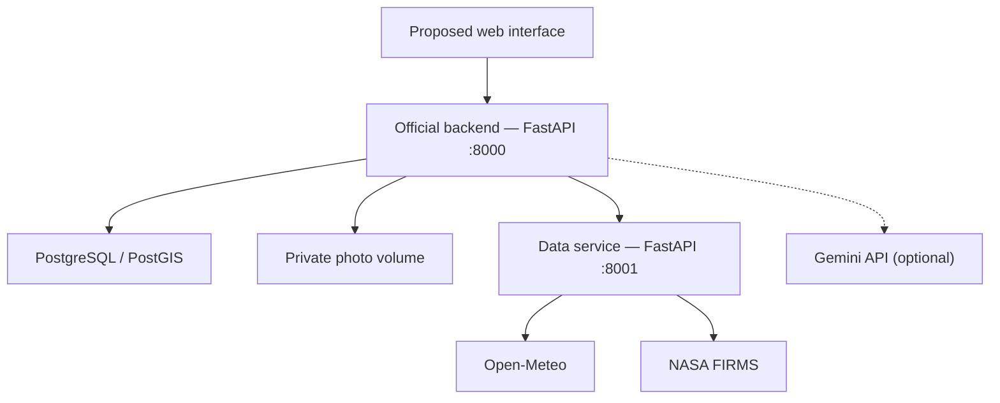
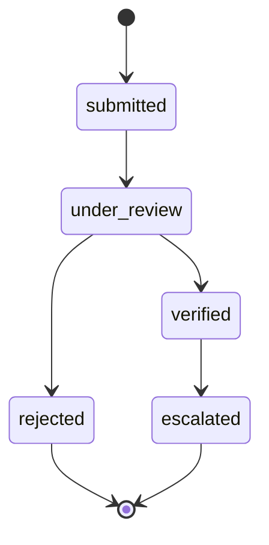

# Terra-Firma

**An MVP for farmer photo reports and cooperative review, with environmental connectors and a selectable Gemini vision adapter. Live vision validation and automatic satellite/weather cross-referencing remain pending.**

**English** · [Português (Brasil)](README.pt-BR.md) · [Repository](https://github.com/armandor123/terra-firma)

A **Group 13** project developed for **Reboot the Earth 2026**. Terra-Firma aims to help combat deforestation, focusing on the prevention and monitoring of vegetation fires and wildfires.

The central idea is for **AI to analyze photographs submitted by farmers for signs of fire, smoke, dry vegetation and burned vegetation**, then cross-reference those findings with **satellite thermal hotspots and weather data**. Cooperatives receive organized evidence to review incidents and coordinate follow-up.

> **Project status:** MVP under development. The previous technical READMEs describe the official backend and environmental data service. The presentation proposes an HTML/CSS/JavaScript web interface and an analysis worker using Google Gemini. **Phase 2 implements selectable simulated/Gemini vision and a validated structured result. Default mode remains simulated; no live Gemini call or visual-quality evaluation has been completed. Automatic environmental cross-referencing is not implemented.** A wildfire risk index is not calculated. Earlier work includes an Expo reference client for potential mobile integration.

> **Phase 0 audit — November 7, 2026:** Source inspected at `1825555f9a714ffab131a3e7796f4223bb753944`. The local suite returned **11 passed, 13 skipped, 1 warning**. Both Compose commands were attempted but Docker is unavailable; PostgreSQL/PostGIS scenarios remain unexecuted in this audit. **Phase 0 is blocked pending full environment and database validation.** See [audit and evidence](docs/AUDITORIA.md) and [decisions](docs/DECISOES.md). No application code changed.

> **CI update — November 7, 2026:** [Full PostGIS suite passed](https://github.com/armandor123/terra-firma/actions/runs/42428442702): **24 tests passed, none skipped**, with one TestClient deprecation warning. Changes are published on `chore/fase-1`; development-stack startup remains unverified. At that revision AI was simulated. Phase 2 now adds selectable Gemini vision; automatic evidence cross-referencing remains unimplemented.

> **Phase 2:** `VisionProvider`, simulated/Gemini adapters and validated per-signal output are implemented in the upload flow. [CI passed all 65 tests](https://github.com/armandor123/terra-firma/actions/runs/42429976440). Default remains simulated. A live Gemini call and image-quality evaluation remain unvalidated; no accuracy claim is made.

## Contents

- [Overview](#overview)
- [Scope and feature status](#scope-and-feature-status)
- [Architecture and technologies](#architecture-and-technologies)
- [Repository structure](#repository-structure)
- [Installation and startup](#installation-and-startup)
- [Configuration](#configuration)
- [Authentication and permissions](#authentication-and-permissions)
- [API reference](#api-reference)
- [Photos, location and retries](#photos-location-and-retries)
- [Environmental data](#environmental-data)
- [Artificial intelligence](#artificial-intelligence)
- [Persistence and operations](#persistence-and-operations)
- [Interface integration](#interface-integration)
- [Testing and validation](#testing-and-validation)
- [Visual identity and credits](#visual-identity-and-credits)
- [Roadmap](#roadmap)
- [Contributing, licensing and references](#contributing-licensing-and-references)

## Overview

### Objective and problem

The main objective is to help protect vegetation and rural communities from vegetation fires and wildfires. Smallholder farmers may struggle to interpret available environmental data, while scattered field reports make monitoring and prioritization difficult for cooperatives.

Terra-Firma proposes bringing the site photograph, authorized location, AI observations and environmental context into one incident record. Identifying dry vegetation is an intended visual capability: a photo may suggest dryness, but cannot independently measure vegetation moisture or establish wildfire risk.

### Core solution: images, AI and satellites

| Evidence | Role in the proposal |
|---|---|
| Farmer photograph | Show local conditions and possible fire, smoke, dry vegetation or burned vegetation |
| Image AI, with selectable Gemini adapter | Identify visual signs and image limitations to support triage |
| Report location and time | Enable spatial and temporal comparison with environmental observations |
| NASA FIRMS | Retrieve nearby thermal hotspots and their observation times |
| Open-Meteo | Add temperature, humidity, wind and precipitation as context |
| Cooperative review | Assess the combined evidence, record a decision and prepare follow-up |

The proposed cross-referencing checks for nearby hotspots with observation times compatible with the report and presents weather as additional context. A photograph may capture something the satellite did not record; the absence of a nearby hotspot must not invalidate the report. Implementing and validating this cross-referencing remains future work.

### Users and proposed journey

| Role | Intended journey |
|---|---|
| Farmer | Log in with username and password, photograph the site, provide authorized location and track their incidents |
| Cooperative representative | Register farmers and properties, review photos and analysis, consult environmental context and prepare communications |

1. The farmer submits a photo and, when authorized, their location.
2. The backend checks access, records the incident and saves the image in private storage.
3. The backend synchronously calls the selected vision provider for the cleaned photograph; the default provider is simulated. Gemini requires server-side credentials and a compatible model.
4. The processor cross-references the findings with nearby thermal hotspots and weather information, retaining source and observation times.
5. The cooperative performs human review and records the incident follow-up.

Step 3 has a configurable implementation, tested with controlled HTTP responses; live Gemini validation is pending. Step 4 remains future work: the environmental service supplies context separately. The platform supports decisions and does not replace emergency services or official warnings. The MVP does not automatically send communications to authorities.

Combating deforestation is the project's purpose. Current scope does not include general tree-clearing detection, deforestation measurement or calculating burned hectares from photographs.

## Scope and feature status

The statuses below were checked against source code during Phase 0. The 13 PostgreSQL-dependent scenarios were subsequently exercised successfully in CI; see Testing and validation. This does not establish production readiness. The presentation describes the product proposal and does not independently demonstrate implementation.

| Feature | Current status |
|---|---|
| Username/password login | Implemented; Argon2 hashing and mandatory initial password change |
| Roles and cooperative isolation | Implemented in the backend |
| Mobile sessions | 15-minute access token and rotating refresh, up to 30 days per session |
| Farmers and properties | Creation and listing; editing/deletion pending |
| Geographic proximity | PostGIS; properties represented as points |
| Incident photographs | Multipart upload, validation, EXIF removal and private storage |
| Duplicate prevention on retries | Per-farmer UUID, transaction and concurrent request locking |
| Incident history and review | Paginated queries and status-change history |
| Reports | Cumulative summary; period filters and exports pending |
| Weather and satellite data | Open-Meteo and NASA FIRMS connectors; explicit demo mode |
| Image AI | VisionProvider with simulated/Gemini implementations; live Gemini validation pending |
| Fire, smoke, dry vegetation and burned vegetation | Structured per-signal output implemented; quality not measured on real photos |
| Automatic image/satellite/weather cross-referencing | Proposed; not implemented in the current flow |
| HTML/CSS/JavaScript web interface | Proposed; no implementation in the audited checkout |
| Wildfire risk index | Not implemented; returns a null value |
| SOS and external communication | Contact details and draft; no automatic dispatch or sending |
| React Native/Expo application | Reference client; no screens, APK or IPA |
| Offline queue, push and polygons | Not implemented |
| INPE and MapBiomas | Potential sources in the PRD; no implemented connectors |

## Architecture and technologies

The presentation defines a target architecture with an **HTML/CSS/JavaScript web interface**, **Python/FastAPI** backend, **PostgreSQL/PostGIS**, a data API and a **Python worker using Google Gemini**. Previous READMEs document the backend and data service, plus a React Native/Expo reference client. The web interface is the product reference for this documentation; the Expo client remains material for potential mobile development.



| Component | Technology and responsibility |
|---|---|
| `backend/` | Python 3.12, FastAPI, Pydantic, psycopg 3, pwdlib/Argon2 and Pillow; users, sessions, properties, photos, review and reports |
| `dados-api/` | Python 3.12, FastAPI and HTTPX; external queries, normalization, partial failures and caching |
| Database | PostgreSQL 16 and PostGIS 3.7, as specified by the Compose image |
| Files | Private volume; the database stores only the photograph reference |
| Proposed interface | HTML, CSS and JavaScript; desktop/mobile browser; Nginx for static files and proxy in the presentation |
| Image processing | Synchronous vision adapter in the backend; Gemini optional, persistent worker and cross-referencing pending |
| Mobile reference | React Native, Expo and TypeScript; earlier integration client, without a complete application |
| Runtime and tests | Docker Compose and pytest |

The diagram above summarizes the documented services and intended interface access. In the target architecture, the worker will read private photos, query Gemini and the data API, and persist results for human review. The persistent queue and worker remain proposed. Phase 2 implements Gemini directly in the backend; it has not been validated with a live API key.

The interface calls the backend. The backend authorizes property access and calls the data service using an internal key. Service credentials must not be distributed in the application.

## Repository structure

| Path | Contents |
|---|---|
| `compose.yaml` / `.env.example` | Development environment and configuration template |
| `compose.test.yaml` / `Dockerfile.tests` | Isolated test environment |
| `backend/backend/main.py` | Backend application and routes |
| `backend/backend/schemas.py` | Input validation |
| `backend/backend/vision.py`, `vision_models.py` | Vision interface, providers and validated output |
| `backend/vision-result.schema.json` | New visual-result JSON schema |
| `backend/backend/db.py`, `storage.py` | Database connection and private storage |
| `backend/backend/migrate.py`, `migrations/` | Migration runner and versioned SQL |
| `backend/backend/bootstrap.py` | First cooperative representative creation |
| `backend/openapi.json` | Backend 2.0.0 contract |
| `backend/incident-metadata.schema.json` | JSON schema for upload metadata |
| `backend/examples/expo-client.ts` | Reference integration client |
| `dados-api/dados/` | Environmental application, models and providers |
| `dados-api/openapi.json`, `example-context.json` | Contract 1.0.0 and demo output example |
| `backend/tests/`, `dados-api/tests/`, `tests/` | Local and integration tests |
| `docs/` | Detailed contracts, mobile integration, demo, validation and roadmap |

The `identidade-visual/` kit was supplied separately. Its paths will only be available on GitHub after the kit is added to the repository.

## Installation and startup

### Requirements

- Git and Docker with Docker Compose v2 for the recommended workflow.
- Internet access to download images/dependencies; environmental demo mode does not query weather/satellite providers; vision is configured separately.
- Python 3.12 for direct execution; the secret-generation command below requires local Python.
- For live mode, provider connectivity and a NASA FIRMS key for real hotspots.

### Start with Docker Compose

```bash
git clone https://github.com/armandor123/terra-firma.git
cd terra-firma
cp .env.example .env
python -c "import secrets; print(secrets.token_urlsafe(32))"
python -c "import secrets; print(secrets.token_urlsafe(32))"
```

Copy the two different generated values into `POSTGRES_PASSWORD` and `DATA_API_KEY` in `.env`. Keep `DATA_MODE=demo` for the first run. The generated password uses characters compatible with the connection URL constructed by Compose.

```bash
docker compose up --build -d
docker compose logs migrate
docker compose exec backend python -m backend.bootstrap \
  --username coop.admin --name "Representative" --cooperative "Demo Cooperative"
```

Bootstrap prompts for a password; there is no default account. The migration must finish successfully before the backend starts. Log in through `/docs`, change the initial password through `/v1/auth/password`, then log in again: changing a password revokes all sessions.

| Service | Local address |
|---|---|
| Backend Swagger | http://127.0.0.1:8000/docs |
| Backend and PostGIS health | http://127.0.0.1:8000/health |
| Data service Swagger | http://127.0.0.1:8001/docs |
| Data service health | http://127.0.0.1:8001/health |

Inspect and stop the environment:

```bash
docker compose ps
docker compose logs backend dados
docker compose down
```

Volumes preserve the database and photographs. **`docker compose down -v` deletes the volumes and their data.**

### Run without Docker

First create a PostgreSQL database with PostGIS available. Inside `dados-api/`, create a virtual environment, install `requirements.txt`, and configure `DATA_API_KEY`, `DATA_MODE` and, if needed, `FIRMS_MAP_KEY`. Start:

```bash
python -m uvicorn dados.main:create_app --factory --host 127.0.0.1 --port 8001
```

In a separate terminal, inside `backend/`, prepare another virtual environment and install its `requirements.txt`. Configure `DATABASE_URL`, `PHOTO_DIR`, `DATA_API_URL` and the same `DATA_API_KEY`. Run:

```bash
python -m backend.migrate
python -m backend.bootstrap --username coop.admin --name "Representative" --cooperative "Demo Cooperative"
python -m uvicorn backend.main:create_app --factory --host 127.0.0.1 --port 8000
```

Python does not load `.env` automatically; export variables in the terminal. The migration role must be able to create the PostGIS extension, or an administrator must install it beforehand. See [backend/README.md](backend/README.md) and [dados-api/README.md](dados-api/README.md) for full virtual-environment commands and PowerShell examples.

## Configuration

| Variable | Purpose | Default / rule |
|---|---|---|
| `POSTGRES_USER` | Compose database user | `terra_firma` |
| `POSTGRES_DB` | Compose database name | `terra_firma` |
| `POSTGRES_PASSWORD` | Database password | Required; keep private |
| `DATA_API_KEY` | Backend-to-data authentication | Required; at least 24 characters in the data service |
| `DATA_MODE` | `demo` or `live` | Compose: `demo`; code without variable: `live` |
| `FIRMS_MAP_KEY` | NASA FIRMS key | Required for real hotspots; distinct from the internal key |
| `BACKEND_BIND` | Host interface exposed by Compose | `127.0.0.1` |
| `DATABASE_URL` | Backend/migration database connection | Built by Compose; required for direct execution |
| `DATA_API_URL` | Internal data service URL | Compose: `http://dados:8001`; direct execution: `http://127.0.0.1:8001` |
| `PHOTO_DIR` | Private image directory | Compose: `/app/data/photos`; direct execution: `./data/photos` |
| `TEST_DATABASE_URL` | Dedicated test database | Set by test Compose |
| `VISION_MODE` | Image provider, independent of DATA_MODE | `simulated` (default) or `gemini` |
| `GEMINI_API_KEY` | Vision credential; backend only | Required in gemini mode |
| `GEMINI_MODEL` | Model ID supporting image input and structured JSON | Required in gemini mode; no assumed default |

Do not commit `.env`, tokens, keys, databases or private photos. For an existing installation, preserve the actual database/user names and Compose project: changing these variables does not rename an initialized database.

## Authentication and permissions

- Technical roles are `farmer` and `cooperative`; the server determines the role after checking credentials.
- Login uses username and password; CPF, Brazil's individual taxpayer identifier, is not collected for authentication.
- Passwords use Argon2 hashing. Tokens are opaque and random; the database stores hashes rather than plaintext tokens.
- Access token: 900 seconds. Refresh: an absolute lifetime of up to 30 days from login, without indefinite extension.
- Refresh rotates both tokens and invalidates the previous pair. Reusing an old refresh token revokes its session.
- Perform only one refresh at a time. If a refresh response is lost, a new login may be necessary.
- Password changes revoke all sessions. Remote logout requires a valid access token; deleting tokens offline does not guarantee server-side revocation.

Login example using operator-defined credentials:

```bash
curl -X POST http://127.0.0.1:8000/v1/auth/login \
  -H 'Content-Type: application/json' \
  -d '{"username":"coop.admin","password":"REPLACE_WITH_YOUR_PASSWORD"}'
```

The response contains `access_token`, `refresh_token`, `token_type`, expiration values, `role` and `must_change_password`. Send `Authorization: Bearer <access_token>` to protected endpoints. New passwords must contain 12–128 characters and differ from the previous password.

## API reference

### Backend — port 8000

| Method | Route | Access / purpose |
|---|---|---|
| GET | `/health` | Public; checks database/PostGIS |
| POST | `/v1/auth/login` | Public; credentials |
| POST | `/v1/auth/refresh` | Valid refresh token; JSON with `refresh_token` |
| GET | `/v1/me` | Authenticated; current user |
| POST | `/v1/auth/password` | Authenticated; `old_password` and `new_password` |
| POST | `/v1/auth/logout` | Authenticated; revoke session |
| POST / GET | `/v1/farmers` | Cooperative; create/list farmers |
| POST | `/v1/properties` | Cooperative; create property |
| GET | `/v1/properties` | Authorized properties |
| GET | `/v1/properties/nearby` | Cooperative; proximity in meters |
| GET | `/v1/properties/{id}/environment` | Property access; environmental context |
| POST | `/v1/incidents` | Farmer; multipart photo and metadata |
| GET | `/v1/incidents` | Authorized incidents; `limit` 1–200, default 50; `offset` ≥ 0 |
| GET | `/v1/incidents/{id}` | Incident access; details and reviews |
| GET | `/v1/incidents/{id}/photo` | Incident access; private image |
| PATCH | `/v1/incidents/{id}/review` | Responsible cooperative; review |
| GET | `/v1/incidents/{id}/notification-draft` | Responsible cooperative; unsent draft |
| GET | `/v1/reports/summary` | Cooperative; cumulative summary |
| GET | `/v1/sos` | Public; contact details without automatic dispatch |

After initial account creation, most routes require the temporary password to be changed. Farmer creation accepts `name` (2–120 characters) and `username` (3–80, ASCII letters, numbers, dot, hyphen or underscore; case-sensitive). The server determines cooperative membership; the response includes a temporary password.

Property creation:

```json
{
  "farmer_id": "FARMER_ID",
  "name": "Hope Farm",
  "municipality": "Campinas",
  "state": "SP",
  "latitude": -22.9,
  "longitude": -47.06,
  "area_ha": 12.5
}
```

Municipality, valid Brazilian state abbreviation, farmer and coordinates are required. Name and area are optional; area must be nonnegative. Nearby search accepts `latitude`, `longitude` and `radius_m` (1–50,000), returning up to 200 properties from the same cooperative, ordered by distance.

### Incident review



Submit `{"status":"under_review","notes":"Report received for human assessment."}` to the review endpoint. Notes must contain 5–2,000 characters. `verified` means internal human assessment; `escalated` is an internal status and does not send information to authorities. Final states allow no further transition.

### Main errors

| HTTP | Meaning |
|---|---|
| 401 | Invalid/expired credential, key or token; reused refresh token |
| 403 | Insufficient role or initial password change required |
| 404 | Missing or unauthorized resource |
| 409 | Duplicate username, invalid transition or UUID reused with different content |
| 413 | Request body exceeds 4,100,000 bytes |
| 422 | Invalid input, metadata or image |
| 429 | Login attempt limit |
| 503 | Data service or photo file unavailable |

## Photos, location and retries

`POST /v1/incidents` accepts **multipart/form-data** with `metadata` as a JSON string (up to 10,000 characters) and `photo` as a JPEG/PNG file (up to 3,000,000 bytes and 12,000,000 pixels).

```json
{
  "client_request_id": "86a0de74-5b4b-4263-98a1-b1b77d415d16",
  "property_id": "PROPERTY_ID",
  "description": "Smoke observed in the distance",
  "latitude": -22.9,
  "longitude": -47.06,
  "location_source": "gps",
  "location_authorized": true
}
```

Optional description: up to 2,000 characters. Latitude and longitude must be provided together. Use `gps` or `manual` with authorization; without location, omit coordinates and use `location_source=unavailable` and `location_authorized=false`. Missing location does not block a report. The backend does not verify the position: it returns `location_verified=false`.

Example after saving the JSON to a local `metadata.json` file:

```bash
curl -X POST http://127.0.0.1:8000/v1/incidents \
  -H "Authorization: Bearer $ACCESS_TOKEN" \
  --form-string "metadata=$(cat metadata.json)" \
  -F 'photo=@photo.jpg;type=image/jpeg'
```

Use a farmer token and that farmer's property. The UUID above is illustrative: generate a new one for each report and preserve it across all retries of that report. The server checks the actual format, reencodes the photo as JPEG and removes EXIF. `photo_base64` is not accepted by contract 2.0.

Creation returns HTTP 201 with `{"id":"...","replayed":false}`. An identical retry returns the same ID with `replayed=true`. Reusing the same UUID with different metadata or file bytes returns 409. Preserve UUID, metadata and file; do not recompress the image on every retry. The key is scoped to each farmer.

## Environmental data

### Operating modes

| Mode | Behavior |
|---|---|
| `demo` | Fictional environmental values dated January 1, 2026; does not select or disable vision |
| `live` | Queries Open-Meteo and NASA FIRMS; failures are explicit, without silently substituting simulated data |

To enable live mode, set `DATA_MODE=live`, provide `FIRMS_MAP_KEY` when available, and recreate the service with `docker compose up -d dados`. Without a NASA key, weather may work while hotspots remain unavailable. DATA_MODE does not select vision. Gemini can be enabled separately with VISION_MODE; no risk index is calculated.

### Data service — port 8001

| Method | Route | Result |
|---|---|---|
| GET | `/health` | Mode and version; public |
| POST | `/v1/context` | Weather, hotspots and risk status |
| POST | `/v1/weather` | Weather envelope |
| POST | `/v1/hotspots` | Hotspot envelope |

POST endpoints require `X-API-Key`. Shared input:

```json
{"latitude":-22.9,"longitude":-47.06,"radius_km":10,"days":1}
```

WGS84 coordinates in decimal degrees; latitude −90 to 90, longitude −180 to 180. Default radius 10 km, range 1–50; default window 1 day, range 1–5. Unknown fields and nonfinite numbers are rejected.

Each source supplies `schema_version`, `source`, `simulated`, `status`, `observed_at`, `fetched_at`, `data` and `warnings`. Status values are `ok`, `stale` and `unavailable`. Display source, reference time, warnings and simulation labels alongside the data.

- Open-Meteo: temperature °C, humidity %, wind km/h/direction in degrees, and precipitation mm. These are weather-model data, not readings from a station installed on the property. Weather references older than three hours are marked `stale`.
- NASA FIRMS: `VIIRS_SNPP_NRT` sensor, UTC acquisition time, `low`/`nominal`/`high` confidence, distance in km and radiative power `frp_mw`. FRP is not area in hectares; confidence is not an application accuracy percentage.
- Hotspots are deduplicated and filtered by distance from the query point; there is no polygon intersection. Queries crossing the antimeridian are unavailable in this version.
- An empty list `[]` differs from unavailable `null`. Partial failures can return HTTP 200 with an `unavailable` envelope; never convert this into zero hotspots or low risk.
- Cache is in memory per process: up to 256 queries for five minutes, only when both sources are `ok`. `fetched_at` retains its original timestamp on cache reads.
- `risk.level=null`, `risk.method=null` and `risk.validated=false` until a method is defined and validated.

Check provider terms, quotas and attribution requirements before publishing the service. Do not log full NASA URLs: they may contain the key.

## Artificial intelligence

### Phase 2 implementation and validation limits

`VisionProvider` defines `analyze(image: bytes) -> VisionResult`. `SimulatedProvider` returns unknown signals and an inconclusive result; `GeminiProvider` sends the cleaned JPEG to Google's `generateContent` API and validates the structured response with Pydantic. Both are wired into incident submission. **Live Gemini execution has not been validated in this delivery: no API key or model was configured. Controlled HTTP tests do not measure visual quality.**

| VISION_MODE / outcome | Stored result |
|---|---|
| `simulated` (default) | `status=simulated`, `simulated=true`, all signals uncertain, `classification=inconclusive` |
| `gemini`, accepted response | `status=completed`, `simulated=false`, validated evidence and provider-returned `model_version` |
| Gemini timeout, blocked/truncated/invalid response, HTTP or transport error | `status=unavailable`, `simulated=false`, unknown signals, `classification=inconclusive`, controlled `error_code` |

`VISION_MODE` is independent of environmental `DATA_MODE`. Gemini requires `GEMINI_API_KEY` and `GEMINI_MODEL` on the backend; missing configuration or an unknown mode fails startup. No model ID is silently assumed. Choose a model available to your account that supports images and structured JSON, and validate it before operational use. Configure `.env`, then recreate the backend:

```bash
# In .env: VISION_MODE=gemini, GEMINI_API_KEY=<server secret>, GEMINI_MODEL=<compatible model ID>
docker compose up --build -d backend
```

The result is returned in the incident's `ai` field and persisted in its existing `ai_json` column. Existing stored results are preserved; replaying an existing UUID does not reanalyze it. No reanalysis endpoint or persistent worker is included.

### Structured output

| Field | Meaning / validation |
|---|---|
| `signals.fire`, `.smoke`, `.dry_vegetation`, `.burned_vegetation` | Each contains `presence` (`present`, `absent`, `uncertain`), `confidence` and a 1–240 character justification |
| `confidence` within each signal | Model-declared value from 0 to 1; null for uncertain signals. **Not calibrated probability or measured accuracy.** Global legacy `confidence` stays null |
| `image_assessable`, `limitations` | Boolean plus `dark`, `blurry`, `no_sky`, `obstructed`, `low_resolution`, `overexposed`, `cropped`, `other`; no invented image limitation on provider failure |
| `classification` | `fire_suspected`, `smoke_suspected`, `dry_vegetation`, `burned_area`, `no_signs`, `inconclusive` |
| `model_version`, `requested_model`, `prompt_version`, `schema_version` | Provider-returned model version after success, configured model ID, `terra-firma-vision-v1`, `1.0`; model version is null for simulation/failure |
| `human_review_required` | Always true. AI never changes the review status automatically |

The four signals are mandatory; unknown fields, nonfinite/out-of-range scores and contradictory classifications are rejected. A suspected class requires the corresponding signal to be present. `no_signs` requires all four signals absent and an assessable image. An unassessable image requires `inconclusive`. `burned_area` means a visual sign of burned vegetation, **not hectares or a confirmed fire**. See [the result schema](backend/vision-result.schema.json) and [implementation decisions and contract](docs/VISAO.md).

### Execution and remaining scope

Authorization and idempotency checks run before the model. Only the reencoded JPEG, instructions and output schema are sent; no farmer metadata, description or location is included. A successful replay does not call Gemini again, including concurrent retries. Provider failures still allow an incident to be stored for human review, with no silent simulation fallback.

Processing is synchronous in the current request/transaction, with HTTP timeouts of 20 seconds per operation (connect: 5 seconds), one attempt and no automatic retry. This adds latency and holds the database lock. A crash after a provider call but before database commit can lead to another billable call on retry; there is no exactly-once external execution guarantee or durable queue. The prompt treats image text as untrusted content; this is a precaution, not a measured prompt-injection guarantee.

Incident upload still does not call the environmental service. `GET /v1/properties/{id}/environment` queries property context separately. Environmental snapshots, photo capture time, image × FIRMS × weather correlation and a risk index remain absent. A single photo cannot establish location, moisture or burned hectares. Lack of signs/hotspots does not establish safety. Next steps are authorized live validation, independent labeled-image evaluation and then the planned worker/correlation work. No AI accuracy metric has been measured.

## Persistence and operations

Main tables are `cooperatives`, `users`, `properties`, `sessions`, `refresh_history`, `incidents` and `reviews`. Farmers belong to cooperatives; properties belong to farmers; incidents reference their property/farmer and have review history. Photographs are stored outside the database.

PostGIS uses `geography(Point,4326)`, a GiST index, `ST_DWithin` and `ST_Distance` in meters. Points are constructed with longitude before latitude; they do not constitute verified property boundaries.

SQL migrations use versioning and checksums, transactions and locking. Do not edit applied migrations: add a new numbered file. There is no automatic downgrade or import from the previous SQLite database.

Compose is a development environment. Before public use, complete HTTPS, separate migration/application credentials, restricted networking, backup and restoration of both database **and** photos, monitoring, distributed limits and security assessment. The current login limiter is in memory per process. A web client requires explicit CORS configuration.

Do not expose `PHOTO_DIR` as a public directory. Multiple instances require shared storage or a private object-storage adapter. A failure between saving a photograph and committing the transaction can leave an orphan file; automatic cleanup is not implemented.

Privacy, retention, a processing notice, restricted access and handling data-subject requests are product-development requirements. This documentation does not attest legal compliance or production approval.

## Interface integration

The web interface proposed in the presentation should implement login, photo submission, location permission, context display and cooperative review. These screens are absent from the audited checkout. Configure CORS or a proxy for the selected origin, retain internal credentials on the server and preserve authentication when retrieving photos.

### Reference for a potential mobile application

The reference [backend/examples/expo-client.ts](backend/examples/expo-client.ts) uses `fetch`, `FormData` and `expo-secure-store`. Install SecureStore in the team's Expo project with `npx expo install expo-secure-store`. Use a single `ApiClient` instance to coordinate refresh operations.

Pending application responsibilities include camera/gallery, HEIC conversion, compression, location permissions, durable photo storage, a per-user offline queue, screens and private-data cleanup on logout. Do not manually set `Content-Type` when sending `FormData`; the client must generate the boundary.

For a phone on the same network, set `BACKEND_BIND=0.0.0.0` on a trusted network, run `docker compose up -d backend`, and use `http://COMPUTER_IP:8000`. On a phone, `localhost` points to the phone itself. Use HTTPS in a public environment.

Never include `DATA_API_KEY`, `FIRMS_MAP_KEY`, `GEMINI_API_KEY` or `DATABASE_URL` in the application; `EXPO_PUBLIC_*` variables are public. Photo URLs require Bearer authentication. See [docs/MOBILE.md](docs/MOBILE.md).

## Testing and validation

**Phase 2 CI: 65 passed, none skipped, 1 warning in 10.57s**, with PostgreSQL/PostGIS. [Run and logs](https://github.com/armandor123/terra-firma/actions/runs/42429976440), tested commit `01ae50dab2e1649a0317bc1069e12b6558c3c6ec`. Local verification had 49 passed/16 skipped without a database; all 16 were subsequently exercised in CI. Gemini tests use controlled HTTP responses, without real inference or quality metrics.

GitHub Actions is configured in [`.github/workflows/tests.yml`](.github/workflows/tests.yml) for pushes, pull requests and manual runs. It uses the isolated `compose.test.yaml` database (`postgis/postgis:16-3.7`), waits for its healthcheck, builds the test image and runs the entire suite. The test service exit code determines the job result; failure diagnostics and container cleanup are configured. No provider credentials are required. **Historical Phase 1 CI passed on November 7, 2026 (São Paulo): 24 passed, no skipped tests, 1 warning in 6.49s.** [Run and logs](https://github.com/armandor123/terra-firma/actions/runs/42428442702), tested commit `4eb09cc86ed3101e1335f180fb84a6439270c714`. All PostgreSQL-dependent scenarios ran against the isolated PostGIS database. The development Compose stack and live providers were not exercised by this workflow.

Full environment with a dedicated temporary database:

```bash
docker compose -f compose.test.yaml up --build --abort-on-container-exit --exit-code-from tests
docker compose -f compose.test.yaml down
```

Alternatively, with dependencies installed, from the repository root:

```bash
python -m pytest -ra -q
```

For this second workflow, configure `TEST_DATABASE_URL` to a **dedicated test database** with PostGIS to run database scenarios. Without it, those scenarios are explicitly skipped. Scenarios create and remove their own schemas.

Phase 1 local verification on November 7, 2026: the default collection found **24 tests**, including the moved integration; execution returned **11 passed, 13 skipped, 1 warning in 0.96s**, exit 0. YAML/Compose configuration and local README links were checked statically. Docker remains unavailable locally; the subsequent GitHub Actions run documented above validates the PostgreSQL/PostGIS suite remotely. Root `conftest.py` remains shared pytest configuration for all three test directories.

The Phase 0 run on November 7, 2026 returned **11 passed, 13 skipped, 1 warning in 0.98s**, exit 0. All 13 skips were caused by missing `TEST_DATABASE_URL`; this is **not a full-suite pass**. Both Compose commands failed before startup with `docker: command not found`. See [docs/AUDITORIA.md](docs/AUDITORIA.md) for file/line evidence and [docs/VALIDACAO.md](docs/VALIDACAO.md) for validation history. The former `resultado-testes.txt` reported 24 passed without commit/environment provenance; Phase 1 removed it from version control and added it to `.gitignore`. Docker/PostGIS, live NASA access, device execution and AI quality remain unvalidated here. Previous SQLite-backend tests do not validate this PostgreSQL version. Phase 1 moved the integration to `tests/test_integration.py` and configured `pytest.ini` to discover all three test directories with the command above.

## Visual identity and credits

**Team — Group 13:** Feliphe Coutinho, Taciára Mendes, Victor Hinoue and Armando de Almeida, as credited in the presentation.

The official project name is **Terra-Firma**. The supplied identity uses the wordmark “Terra Firma”. Older names in source documents have been standardized in this documentation.

| Element | Kit guideline |
|---|---|
| Primary navy | `#1B3550` |
| Dark navy | `#12263A` |
| Action blue | `#1F5F8B`, buttons and links |
| Accent blue | `#009EDB`, details; avoid text on white |
| Background / text | `#F3F4F6` / `#1F2933` |
| Typography | Roboto in app/site; Arial in presentations |
| Future risk color scale | Low `#4B7F52`, moderate `#B08A1E`, high `#C0612B`, very high `#A4262C` |

Risk colors are visual tokens, not backend-calculated classifications. Demonstrations with fictional values must display **SIMULATED DATA** or “illustrative values”.

The identity ZIP contains SVG/PNG logos, 30 icons, photographs/crops, a palette, CSS tokens and `moodboard.html`. When adding it to the repository, preserve `fotos/creditos.md` and `parceiros/LEIAME.md`.

- Commons photographs: José Cruz/Agência Brasil and Marcelo Camargo/Agência Brasil, CC BY 3.0 BR; Agência Brasil and Ibama, CC BY 2.0; Emilio Swany Guerreiro, CC BY-SA 4.0. Full image-by-image credits and original links are provided in the kit and must accompany reuse.
- Adaptations of `pos-arara-cinzas` follow the same CC BY-SA 4.0 license. Other team-supplied photos require confirmation of source/permission; `agricultor-queimada-roca.jpg` requires documented image authorization under the kit's guidance.
- Icons: Font Awesome Free, CC BY 4.0 attribution as stated in the kit.
- UN OICT and NTT DATA should appear only as challenge-organizer credits, separated from the product brand. Prefer text attribution when brand-use guidance is unavailable.

**Independent project by challenge participants. Trademarks belong to their respective owners.**

## Roadmap

| Priority | Next deliverable |
|---|---|
| 1 | Execute and record PostgreSQL/PostGIS tests and resolve failures |
| 2 | Implement the presentation's web interface with photo, location and review flows |
| 3 | Validate live connectors, availability and data presentation |
| 4 | Validate Gemini with authorized photos, then implement satellite/weather cross-referencing and retain human review |
| 5 | Add filters/exports, reviewed notifications and usage metrics |
| 6 | Assess polygons, historical sources and validated risk/spread methods |

Planned indicators include registered farmers/properties, registered area, reporting time, geolocation rate, review rate, integration failures and AI quality after evaluation. Registered area is not burned area; reduced damage or prevented fires require separate evidence.

The Terra-Firma 2.0 proposal includes exploring points, rewards and recognition for useful, verifiable reports, alongside expanded notifications and institutional partnerships. These are future ideas. Tax benefits require assessment and decisions by competent institutions. As stated in the presentation, penalties for not submitting photos are outside the MVP.

## Contributing, licensing and references

To contribute, open an issue with context and the expected result, work on a branch, and submit a pull request describing the change and validation. Update contracts and documentation when changing the API. Use fictional or authorized data and preserve the distinction between real and simulated results.

No `LICENSE` file was identified in the reviewed revision. The code license must be defined by the project owner; do not assume MIT or another license. Photographs, icons and trademarks have separate conditions.

Phase 1 records **MIT as a proposal, pending the authors' decision**, in [docs/DECISOES.md](docs/DECISOES.md); it has not been adopted. That document also contains a suggested repository About description; no remote metadata was changed.

Additional technical documentation, currently in Portuguese:

- [Inputs and contracts](docs/INPUTS-E-CONTRATOS.md)
- [Technical explanation](docs/EXPLICACAO-TECNICA.md)
- [Demonstration guide](docs/ROTEIRO-DEMO.md)
- [Scope and roadmap](docs/ESCOPO-E-EVOLUCAO.md)
- [Validation](docs/VALIDACAO.md)
- [AI and testing plan](docs/PLANO-IA-E-TESTES.md)

Connector references: [Open-Meteo](https://open-meteo.com/en/docs) and [NASA FIRMS API](https://firms.modaps.eosdis.nasa.gov/api/).

**Historical Phase 0 update basis — November 7, 2026:** Phase 0 source audit of revision `1825555f9a714ffab131a3e7796f4223bb753944` and the local test execution recorded above. Product, presentation and visual-identity descriptions were retained from the November 6 documentation; their external assets were not revalidated. No new live-provider or model call was made. This phase changes documentation only and remains blocked for full database/environment validation.
