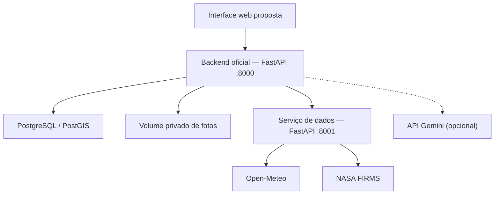
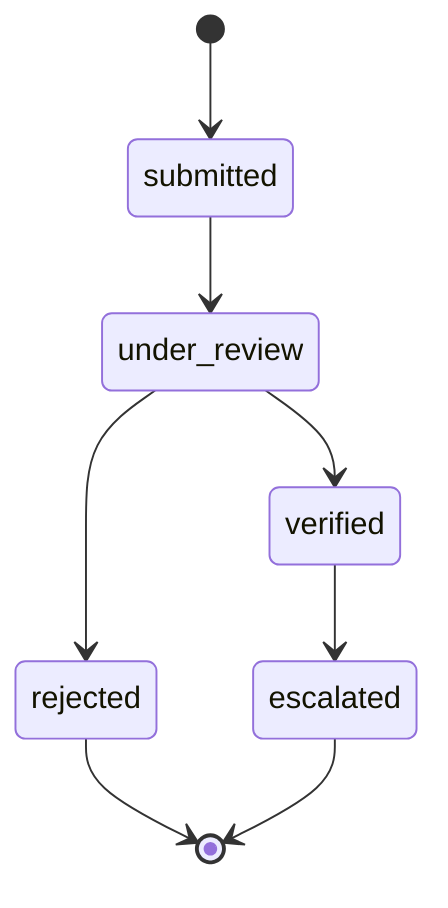

# Terra-Firma

**MVP de relatos com fotos por agricultores e revisão por cooperativas, com conectores ambientais e adaptador Gemini selecionável. Avaliação em fotos reais e cruzamento automático com satélite/clima permanecem pendentes.**

[English](README.md) · **Português (Brasil)** · [Repositório](https://github.com/armandor123/terra-firma)

Projeto do **Grupo 13**, desenvolvido para o desafio **Reboot the Earth 2026**. O Terra-Firma tem como objetivo apoiar o combate ao desmatamento, com foco na prevenção e no acompanhamento de queimadas e incêndios florestais.

A ideia central é permitir que **a IA analise fotos enviadas pelo produtor para identificar indícios de focos de incêndio, fumaça, mata seca e vegetação queimada**, cruzando essas evidências com **focos de calor de satélite e dados meteorológicos**. A cooperativa recebe informações organizadas para revisar ocorrências e coordenar encaminhamentos.

> **Estado do projeto:** MVP em desenvolvimento. O backend oficial e o serviço de dados ambientais estão descritos nos READMEs técnicos anteriores. A apresentação propõe interface web em HTML/CSS/JavaScript e um processador de análise com Google Gemini. **A Fase 2 implementa visão simulada/Gemini selecionável e resultado estruturado validado. O padrão continua simulado. Uma chamada Gemini real com imagem sintética funcionou; a qualidade visual continua sem avaliação. O cruzamento automático ambiental não está implementado.** O índice de risco também não é calculado. O histórico contém um cliente Expo de referência para possível integração mobile.

> **Auditoria da Fase 0 — 07/11/2026:** Código inspecionado em `1825555f9a714ffab131a3e7796f4223bb753944`. A suíte local retornou **11 aprovados, 13 ignorados e 1 aviso**. Os dois comandos Compose foram tentados, mas Docker não está disponível; os cenários PostgreSQL/PostGIS continuam sem execução nesta auditoria. **Fase 0 bloqueada até a validação integral do ambiente e do banco.** Veja [auditoria e evidências](docs/AUDITORIA.md) e [decisões](docs/DECISOES.md). Nenhum código de aplicação foi alterado.

> **Atualização de CI — 07/11/2026:** [Suíte completa com PostGIS aprovada](https://github.com/armandor123/terra-firma/actions/runs/42428442702): **24 testes aprovados, nenhum ignorado**, com um aviso de depreciação do TestClient. Mudanças publicadas em `chore/fase-1`; inicialização do ambiente de desenvolvimento ainda não verificada. Naquela revisão a IA era simulada. A Fase 2 adiciona visão Gemini selecionável; o cruzamento automático continua não implementado.

> **Fase 2:** `VisionProvider`, adaptadores simulated/Gemini e saída validada por sinal estão implementados no envio. [CI aprovou os 65 testes](https://github.com/armandor123/terra-firma/actions/runs/42429976440). O padrão continua simulado. Chamada Gemini real validada com imagem sintética; qualidade em fotos reais não avaliada e nenhuma acurácia alegada.

## Sumário

- [Visão geral](#visão-geral)
- [Escopo e estado das funcionalidades](#escopo-e-estado-das-funcionalidades)
- [Arquitetura e tecnologias](#arquitetura-e-tecnologias)
- [Estrutura do repositório](#estrutura-do-repositório)
- [Instalação e execução](#instalação-e-execução)
- [Configuração](#configuração)
- [Autenticação e permissões](#autenticação-e-permissões)
- [Referência das APIs](#referência-das-apis)
- [Fotos, localização e reenvios](#fotos-localização-e-reenvios)
- [Dados ambientais](#dados-ambientais)
- [Inteligência artificial](#inteligência-artificial)
- [Persistência e operação](#persistência-e-operação)
- [Integração da interface](#integração-da-interface)
- [Testes e validação](#testes-e-validação)
- [Identidade visual e créditos](#identidade-visual-e-créditos)
- [Evolução do projeto](#evolução-do-projeto)
- [Contribuição, licença e referências](#contribuição-licença-e-referências)

## Visão geral

### Objetivo e problema

O objetivo principal é apoiar a proteção da vegetação e das comunidades rurais diante de queimadas e incêndios. Pequenos produtores nem sempre conseguem interpretar os dados ambientais disponíveis, e relatos dispersos dificultam o acompanhamento e a priorização pela cooperativa.

O Terra-Firma propõe reunir a foto do local, a localização autorizada, os indícios observados pela IA e o contexto ambiental em uma mesma ocorrência. A identificação de mata seca é uma capacidade visual pretendida: uma fotografia pode sugerir vegetação ressecada, mas não mede, sozinha, a umidade do material nem comprova o risco de incêndio.

### Núcleo da solução: imagem, IA e satélites

| Evidência | Papel na proposta |
|---|---|
| Foto do produtor | Mostrar as condições locais e possíveis sinais de fogo, fumaça, vegetação seca ou queimada |
| IA de imagem, com adaptador Gemini selecionável | Apontar indícios visuais e limitações da imagem para apoiar a triagem |
| Localização e horário do relato | Permitir comparação espacial e temporal com observações ambientais |
| NASA FIRMS | Consultar focos de calor próximos e seus horários de observação |
| Open-Meteo | Acrescentar temperatura, umidade, vento e precipitação ao contexto |
| Revisão da cooperativa | Avaliar as evidências reunidas, registrar a decisão e preparar encaminhamentos |

O cruzamento pretendido verifica se há focos de calor próximos e temporalmente compatíveis com o relato e apresenta o clima como contexto complementar. A foto pode mostrar algo que o satélite não registrou; a ausência de foco próximo não deve invalidar o relato. A implementação e a validação desse cruzamento são etapas futuras.

### Público e jornada proposta

| Perfil | Jornada prevista |
|---|---|
| Produtor rural | Entrar com usuário e senha, fotografar o local, informar localização autorizada e acompanhar suas ocorrências |
| Representante da cooperativa | Cadastrar produtores e propriedades, revisar fotos e análises, consultar contexto ambiental e preparar comunicações |

1. O produtor envia uma foto e, quando autorizado, sua localização.
2. O backend valida o acesso, registra a ocorrência e guarda a imagem em armazenamento privado.
3. O backend chama de forma síncrona o provedor de visão selecionado para a foto limpa; o padrão é simulado. Gemini exige credencial no servidor e modelo compatível.
4. O processador cruza os indícios com focos de calor próximos e informações meteorológicas, preservando origem e horário dos dados.
5. A cooperativa realiza a revisão humana e registra o encaminhamento da ocorrência.

O passo 3 tem implementação configurável, testada com HTTP controlado; uma chamada real com imagem sintética já passou, mas a validação com fotos reais continua pendente. O passo 4 continua futuro: o serviço ambiental fornece contexto separadamente. A plataforma apoia decisões e não substitui serviços de emergência ou alertas oficiais. O MVP não envia comunicações automaticamente às autoridades.

O combate ao desmatamento é a finalidade do projeto. O escopo atual não inclui detecção geral de corte de árvores, medição de desmatamento ou cálculo de hectares queimados por fotografia.

## Escopo e estado das funcionalidades

Os estados abaixo foram conferidos contra o código na Fase 0. Os 13 cenários dependentes de PostgreSQL foram posteriormente executados com sucesso no CI; veja Testes e validação. Isso não comprova prontidão para produção. A apresentação descreve a proposta de produto e não comprova, por si só, implementação.

| Funcionalidade | Estado atual |
|---|---|
| Login por nome de usuário e senha | Implementado; hash Argon2 e troca de senha inicial |
| Perfis e isolamento entre cooperativas | Implementados no backend |
| Sessão mobile | Access token de 15 minutos e refresh com rotação, até 30 dias por sessão |
| Produtores e propriedades | Criação e listagem; edição/exclusão pendentes |
| Proximidade geográfica | PostGIS; propriedades representadas por pontos |
| Fotos de ocorrências | Upload multipart, validação, remoção de EXIF e armazenamento privado |
| Reenvio sem duplicação | UUID por produtor, transação e bloqueio de requisições concorrentes |
| Histórico e revisão | Consulta paginada e histórico de alterações de status |
| Relatórios | Resumo acumulado; filtros por período e exportações pendentes |
| Meteorologia e satélite | Conectores Open-Meteo e NASA FIRMS; modo demo explícito |
| IA de imagens | VisionProvider com implementações simulated/Gemini; chamada real sintética validada; avaliação em fotos reais pendente |
| Fogo, fumaça, mata seca e vegetação queimada | Saída estruturada por sinal implementada; qualidade não medida em fotos reais |
| Cruzamento automático entre imagem, satélite e clima | Proposto; não implementado no fluxo atual |
| Interface web HTML/CSS/JavaScript | Proposta; sem implementação no checkout auditado |
| Índice de risco de incêndio | Não implementado; retorna valor nulo |
| SOS e comunicação externa | Contato e minuta; sem despacho ou envio automático |
| Aplicativo React Native/Expo | Cliente de referência; sem telas, APK ou IPA |
| Fila offline, push e polígonos | Não implementados |
| INPE e MapBiomas | Fontes previstas no PRD; sem conectores implementados |

## Arquitetura e tecnologias

A apresentação define a arquitetura pretendida com **interface web HTML/CSS/JavaScript**, backend **Python/FastAPI**, **PostgreSQL/PostGIS**, API de dados e **worker Python com Google Gemini**. Os READMEs anteriores documentam o backend e o serviço de dados, além de um cliente React Native/Expo de referência. A interface web passa a ser a referência de produto desta documentação; o cliente Expo permanece como material para possível evolução mobile.



| Componente | Tecnologia e responsabilidade |
|---|---|
| `backend/` | Python 3.12, FastAPI, Pydantic, psycopg 3, pwdlib/Argon2 e Pillow; usuários, sessões, propriedades, fotos, revisão e relatórios |
| `dados-api/` | Python 3.12, FastAPI e HTTPX; consultas externas, normalização, falhas parciais e cache |
| Banco | PostgreSQL 16 e PostGIS 3.7, conforme a imagem do Compose |
| Arquivos | Volume privado; o banco armazena somente a referência da fotografia |
| Interface proposta | HTML, CSS e JavaScript; navegador no computador ou celular; Nginx para arquivos e proxy na apresentação |
| Processamento de imagens | Adaptador síncrono no backend; Gemini opcional, worker persistente e cruzamento pendentes |
| Referência mobile | React Native, Expo e TypeScript; cliente de integração anterior, sem aplicativo completo |
| Execução e testes | Docker Compose e pytest |

O diagrama acima resume os serviços documentados e o acesso previsto pela interface. Na arquitetura de evolução, o worker acessará as fotos privadas, consultará o Gemini e a API de dados e persistirá os resultados para revisão humana. Fila persistente e worker continuam propostos. A Fase 2 implementa Gemini diretamente no backend; chamada API real com imagem sintética validada. Veja [evidência](docs/vision-live-check.json).

A interface acessa o backend. O backend autoriza o acesso à propriedade e consulta o serviço de dados usando uma chave interna. As credenciais dos serviços não devem ser distribuídas no aplicativo.

## Estrutura do repositório

| Caminho | Conteúdo |
|---|---|
| `compose.yaml` / `.env.example` | Ambiente de desenvolvimento e modelo de configuração |
| `compose.test.yaml` / `Dockerfile.tests` | Ambiente isolado de testes |
| `backend/backend/main.py` | Aplicação e rotas do backend |
| `backend/backend/schemas.py` | Validação das entradas |
| `backend/backend/vision.py`, `vision_models.py` | Interface, provedores de visão e saída validada |
| `backend/vision-result.schema.json` | JSON schema do novo resultado visual |
| `backend/backend/db.py`, `storage.py` | Conexão ao banco e armazenamento privado |
| `backend/backend/migrate.py`, `migrations/` | Migrador e SQL versionado |
| `backend/backend/bootstrap.py` | Criação do primeiro representante da cooperativa |
| `backend/openapi.json` | Contrato do backend 2.0.0 |
| `backend/incident-metadata.schema.json` | Schema do JSON de metadata do upload |
| `backend/examples/expo-client.ts` | Cliente de integração de referência |
| `dados-api/dados/` | Aplicação, modelos e provedores ambientais |
| `dados-api/openapi.json`, `example-context.json` | Contrato 1.0.0 e exemplo do modo demo |
| `backend/tests/`, `dados-api/tests/`, `tests/` | Testes locais e de integração |
| `docs/` | Contratos detalhados, integração mobile, demonstração, validação e evolução |

O kit `identidade-visual/` foi fornecido separadamente. Os caminhos desse kit só estarão disponíveis no GitHub depois de sua inclusão no repositório.

## Instalação e execução

### Requisitos

- Git e Docker com Docker Compose v2 para o fluxo recomendado.
- Acesso à internet para baixar imagens/dependências; o modo demo ambiental não consulta clima/satélite; visão é configurada separadamente.
- Python 3.12 para execução direta; o comando de geração de segredos abaixo requer Python local.
- Para modo live, conectividade com os provedores e uma chave NASA FIRMS para os focos de calor.

### Iniciar com Docker Compose

```bash
git clone https://github.com/armandor123/terra-firma.git
cd terra-firma
cp .env.example .env
python -c "import secrets; print(secrets.token_urlsafe(32))"
python -c "import secrets; print(secrets.token_urlsafe(32))"
```

Copie os dois valores diferentes gerados para `POSTGRES_PASSWORD` e `DATA_API_KEY` no `.env`. Mantenha `DATA_MODE=demo` na primeira execução. A senha gerada usa caracteres compatíveis com a URL de conexão montada pelo Compose.

```bash
docker compose up --build -d
docker compose logs migrate
docker compose exec backend python -m backend.bootstrap \
  --username coop.admin --name "Representante" --cooperative "Cooperativa Demo"
```

O bootstrap solicita uma senha; não existe conta padrão. A migração precisa terminar com sucesso para o backend iniciar. Faça login em `/docs`, troque a senha inicial em `/v1/auth/password` e entre novamente: a troca revoga todas as sessões.

| Serviço | Endereço local |
|---|---|
| Swagger do backend | http://127.0.0.1:8000/docs |
| Saúde do backend e PostGIS | http://127.0.0.1:8000/health |
| Swagger do serviço de dados | http://127.0.0.1:8001/docs |
| Saúde do serviço de dados | http://127.0.0.1:8001/health |

Para acompanhar e encerrar o ambiente:

```bash
docker compose ps
docker compose logs backend dados
docker compose down
```

Os volumes preservam banco e fotografias. **`docker compose down -v` remove os volumes e seus dados.**

### Executar sem Docker

Crie previamente um banco PostgreSQL com PostGIS disponível. No diretório `dados-api/`, crie um ambiente virtual, instale `requirements.txt`, configure `DATA_API_KEY`, `DATA_MODE` e, se necessário, `FIRMS_MAP_KEY`. Inicie:

```bash
python -m uvicorn dados.main:create_app --factory --host 127.0.0.1 --port 8001
```

Em outro terminal, dentro de `backend/`, prepare outro ambiente virtual e instale seu `requirements.txt`. Configure `DATABASE_URL`, `PHOTO_DIR`, `DATA_API_URL` e a mesma `DATA_API_KEY`. Execute:

```bash
python -m backend.migrate
python -m backend.bootstrap --username coop.admin --name "Representante" --cooperative "Cooperativa Demo"
python -m uvicorn backend.main:create_app --factory --host 127.0.0.1 --port 8000
```

O Python não carrega `.env` automaticamente; exporte as variáveis no terminal. O usuário do migrador precisa poder criar a extensão PostGIS, ou ela deve estar instalada previamente. Consulte [backend/README.md](backend/README.md) e [dados-api/README.md](dados-api/README.md) para os comandos completos de ambiente virtual e exemplos PowerShell.

## Configuração

| Variável | Uso | Padrão / regra |
|---|---|---|
| `POSTGRES_USER` | Usuário do banco no Compose | `terra_firma` |
| `POSTGRES_DB` | Nome do banco no Compose | `terra_firma` |
| `POSTGRES_PASSWORD` | Senha do banco | Obrigatória; manter privada |
| `DATA_API_KEY` | Autenticação entre backend e dados | Obrigatória; mínimo de 24 caracteres no serviço de dados |
| `DATA_MODE` | `demo` ou `live` | Compose: `demo`; código sem variável: `live` |
| `FIRMS_MAP_KEY` | Chave da NASA FIRMS | Necessária para focos reais; diferente da chave interna |
| `BACKEND_BIND` | Interface do host exposta pelo Compose | `127.0.0.1` |
| `DATABASE_URL` | Conexão do backend/migrador | Montada pelo Compose; obrigatória na execução direta |
| `DATA_API_URL` | URL interna do serviço de dados | Compose: `http://dados:8001`; execução direta: `http://127.0.0.1:8001` |
| `PHOTO_DIR` | Diretório privado de imagens | Compose: `/app/data/photos`; execução direta: `./data/photos` |
| `TEST_DATABASE_URL` | Banco exclusivo para testes | Configurado no Compose de testes |
| `VISION_MODE` | Provedor de imagem, independente de DATA_MODE | `simulated` (padrão) ou `gemini` |
| `GEMINI_API_KEY` | Credencial de visão, somente no backend | Obrigatória no modo gemini |
| `GEMINI_MODEL` | ID de modelo com visão e JSON estruturado | Obrigatório no modo gemini; sem padrão presumido |

Não envie `.env`, tokens, chaves, bancos ou fotos privadas ao GitHub. Em uma instalação existente, preserve nomes reais do banco/usuário e o projeto Compose: mudar essas variáveis não renomeia um banco já inicializado.

## Autenticação e permissões

- Os papéis técnicos são `farmer` e `cooperative`; o servidor define o papel após verificar as credenciais.
- O login utiliza username e senha; CPF não é coletado para autenticação.
- Senhas são armazenadas com hash Argon2. Tokens são opacos e aleatórios; o banco mantém seus hashes, não tokens em texto puro.
- Access token: 900 segundos. Refresh: prazo absoluto de até 30 dias desde o login, sem extensão indefinida.
- A renovação troca ambos os tokens e invalida os anteriores. Reutilizar refresh antigo revoga a sessão correspondente.
- Faça uma única renovação por vez. Se a resposta de renovação se perder, pode ser necessário novo login.
- A troca de senha revoga todas as sessões. Logout remoto requer access token válido; apagar tokens offline não garante revogação no servidor.

Exemplo de login, com credenciais escolhidas pelo operador:

```bash
curl -X POST http://127.0.0.1:8000/v1/auth/login \
  -H 'Content-Type: application/json' \
  -d '{"username":"coop.admin","password":"SUBSTITUA_PELA_SUA_SENHA"}'
```

A resposta contém `access_token`, `refresh_token`, `token_type`, prazos, `role` e `must_change_password`. Nas rotas protegidas, envie `Authorization: Bearer <access_token>`. A nova senha deve ter 12–128 caracteres e ser diferente da anterior.

## Referência das APIs

### Backend — porta 8000

| Método | Rota | Acesso / finalidade |
|---|---|---|
| GET | `/health` | Público; verifica banco/PostGIS |
| POST | `/v1/auth/login` | Público; credenciais |
| POST | `/v1/auth/refresh` | Refresh válido; JSON com `refresh_token` |
| GET | `/v1/me` | Autenticado; dados do usuário |
| POST | `/v1/auth/password` | Autenticado; `old_password` e `new_password` |
| POST | `/v1/auth/logout` | Autenticado; revoga sessão |
| POST / GET | `/v1/farmers` | Cooperativa; cadastrar/listar produtores |
| POST | `/v1/properties` | Cooperativa; cadastrar propriedade |
| GET | `/v1/properties` | Propriedades autorizadas |
| GET | `/v1/properties/nearby` | Cooperativa; proximidade em metros |
| GET | `/v1/properties/{id}/environment` | Acesso à propriedade; contexto ambiental |
| POST | `/v1/incidents` | Produtor; foto e metadata multipart |
| GET | `/v1/incidents` | Ocorrências autorizadas; `limit` 1–200, padrão 50; `offset` ≥ 0 |
| GET | `/v1/incidents/{id}` | Acesso à ocorrência; detalhes e revisões |
| GET | `/v1/incidents/{id}/photo` | Acesso à ocorrência; imagem privada |
| PATCH | `/v1/incidents/{id}/review` | Cooperativa responsável; revisão |
| GET | `/v1/incidents/{id}/notification-draft` | Cooperativa responsável; minuta não enviada |
| GET | `/v1/reports/summary` | Cooperativa; resumo acumulado |
| GET | `/v1/sos` | Público; contato, sem acionamento automático |

Após a criação inicial, a maioria das rotas exige troca da senha temporária. O cadastro de produtor recebe `name` (2–120 caracteres) e `username` (3–80, letras ASCII, números, ponto, hífen ou sublinhado; diferencia maiúsculas/minúsculas). A cooperativa é determinada no servidor; a resposta inclui senha temporária.

Cadastro de propriedade:

```json
{
  "farmer_id": "ID_DO_PRODUTOR",
  "name": "Sítio Esperança",
  "municipality": "Campinas",
  "state": "SP",
  "latitude": -22.9,
  "longitude": -47.06,
  "area_ha": 12.5
}
```

Município, UF brasileira válida, produtor e coordenadas são obrigatórios. Nome e área são opcionais; área não negativa. A busca próxima recebe `latitude`, `longitude` e `radius_m` (1–50.000), devolvendo até 200 propriedades da própria cooperativa ordenadas por distância.

### Revisão de ocorrências



Envie `{"status":"under_review","notes":"Registro recebido para avaliação humana."}` na revisão. As notas devem ter 5–2.000 caracteres. `verified` significa avaliação humana interna; `escalated` é um status interno, sem envio automático a autoridades. Estados finais não permitem nova transição.

### Erros principais

| HTTP | Significado |
|---|---|
| 401 | Credencial, chave ou token inválido/expirado; refresh reutilizado |
| 403 | Perfil insuficiente ou troca inicial de senha pendente |
| 404 | Recurso inexistente ou não autorizado |
| 409 | Username duplicado, transição inválida ou UUID reaproveitado com conteúdo diferente |
| 413 | Corpo da requisição acima de 4.100.000 bytes |
| 422 | Entrada, metadata ou imagem inválida |
| 429 | Limite de tentativas de login |
| 503 | Serviço de dados ou arquivo de foto indisponível |

## Fotos, localização e reenvios

`POST /v1/incidents` recebe **multipart/form-data**, com `metadata` como texto JSON (até 10.000 caracteres) e `photo` como arquivo JPEG/PNG (até 3.000.000 bytes e 12.000.000 pixels).

```json
{
  "client_request_id": "86a0de74-5b4b-4263-98a1-b1b77d415d16",
  "property_id": "ID_DA_PROPRIEDADE",
  "description": "Fumaça observada ao longe",
  "latitude": -22.9,
  "longitude": -47.06,
  "location_source": "gps",
  "location_authorized": true
}
```

Descrição opcional: até 2.000 caracteres. Latitude e longitude devem vir juntas. Use `gps` ou `manual` com autorização; sem localização, omita as coordenadas e use `location_source=unavailable` e `location_authorized=false`. A ausência de localização não impede o relato. O backend não comprova a posição: retorna `location_verified=false`.

Exemplo, após salvar o JSON em um arquivo local `metadata.json`:

```bash
curl -X POST http://127.0.0.1:8000/v1/incidents \
  -H "Authorization: Bearer $ACCESS_TOKEN" \
  --form-string "metadata=$(cat metadata.json)" \
  -F 'photo=@foto.jpg;type=image/jpeg'
```

Use um token de produtor e sua propriedade. O UUID acima é ilustrativo: gere um novo por relato e preserve-o em todos os reenvios desse relato. O servidor verifica o formato real, reencodifica a foto em JPEG e remove EXIF. `photo_base64` não é aceito no contrato 2.0.

A criação retorna HTTP 201 com `{"id":"...","replayed":false}`. Reenvio idêntico retorna o mesmo ID e `replayed=true`. Mesmo UUID com metadata ou bytes diferentes retorna 409. Preserve UUID, metadata e arquivo; não recomprima a imagem a cada tentativa. A chave é isolada por produtor.

## Dados ambientais

### Modos de operação

| Modo | Comportamento |
|---|---|
| `demo` | Valores ambientais fictícios de 01/01/2026; não seleciona nem desativa a visão |
| `live` | Consulta Open-Meteo e NASA FIRMS; falhas ficam explícitas, sem substituir silenciosamente por simulação |

Para ativar live, configure `DATA_MODE=live`, forneça `FIRMS_MAP_KEY` quando disponível e recrie o serviço com `docker compose up -d dados`. Sem chave NASA, a meteorologia pode funcionar enquanto os focos ficam indisponíveis. DATA_MODE não seleciona a visão. Gemini pode ser ativado separadamente por VISION_MODE; não há índice de risco calculado.

### Serviço de dados — porta 8001

| Método | Rota | Resultado |
|---|---|---|
| GET | `/health` | Modo e versão; público |
| POST | `/v1/context` | Meteorologia, focos e estado do risco |
| POST | `/v1/weather` | Envelope meteorológico |
| POST | `/v1/hotspots` | Envelope de focos |

As rotas POST exigem `X-API-Key`. Entrada comum:

```json
{"latitude":-22.9,"longitude":-47.06,"radius_km":10,"days":1}
```

Coordenadas WGS84 em graus decimais; latitude entre −90 e 90, longitude entre −180 e 180. Raio padrão 10 km, intervalo 1–50; janela padrão 1 dia, intervalo 1–5. Campos desconhecidos e números não finitos são rejeitados.

Cada fonte informa `schema_version`, `source`, `simulated`, `status`, `observed_at`, `fetched_at`, `data` e `warnings`. Os status são `ok`, `stale` e `unavailable`. Exiba origem, referência temporal, avisos e indicação de simulação junto dos dados.

- Open-Meteo: temperatura °C, umidade %, vento km/h/direção em graus e precipitação mm. São dados de modelo meteorológico; não representam uma estação instalada na propriedade. Referência meteorológica com mais de três horas é marcada como `stale`.
- NASA FIRMS: sensor `VIIRS_SNPP_NRT`, horário UTC de aquisição, confiança `low`/`nominal`/`high`, distância em km e potência radiativa `frp_mw`. FRP não é área em hectares; confiança não é uma porcentagem de acerto do aplicativo.
- Focos passam por deduplicação e filtragem por distância ao ponto consultado; não há interseção com polígonos. Consultas que cruzam o antimeridiano ficam indisponíveis nesta versão.
- Lista vazia `[]` difere de `null` indisponível. Falhas parciais podem retornar HTTP 200 com envelope `unavailable`; nunca transforme isso em zero focos ou risco baixo.
- O cache é em memória, por processo: até 256 consultas por cinco minutos, somente quando ambas as fontes estão `ok`. `fetched_at` conserva o horário original ao ler cache.
- `risk.level=null`, `risk.method=null` e `risk.validated=false` até definição e validação de um método.

Consulte os termos, cotas e atribuições dos provedores antes de publicar o serviço. Não registre URLs completas NASA em logs: elas podem conter a chave.

## Inteligência artificial

### Implementação da Fase 2 e limites da validação

`VisionProvider` define `analyze(image: bytes) -> VisionResult`. `SimulatedProvider` retorna sinais desconhecidos e resultado inconclusivo; `GeminiProvider` envia o JPEG limpo à API `generateContent` do Google e valida a resposta estruturada com Pydantic. Ambos estão ligados ao envio de ocorrência. **Uma chamada real com `gemini-3.8-flash` funcionou usando imagem sintética uniforme: HTTP 200, `status=completed`, `simulated=false`, `classification=inconclusive`. [Evidência](docs/vision-live-check.json). Isso valida o contrato adaptador/API em um exemplo, não a qualidade de detecção nem uma ocorrência real persistida de ponta a ponta. A credencial foi usada apenas em memória, sem salvamento.**

| VISION_MODE / resultado | Resultado armazenado |
|---|---|
| `simulated` (padrão) | `status=simulated`, `simulated=true`, sinais incertos, `classification=inconclusive` |
| `gemini`, resposta aceita | `status=completed`, `simulated=false`, evidências validadas e `model_version` devolvida pelo provedor |
| Timeout, resposta bloqueada/truncada/inválida, erro HTTP ou transporte Gemini | `status=unavailable`, `simulated=false`, sinais desconhecidos, `classification=inconclusive`, `error_code` controlado |

`VISION_MODE` independe do `DATA_MODE` ambiental. Gemini exige `GEMINI_API_KEY` e `GEMINI_MODEL` no backend; falta de configuração ou modo desconhecido impede o startup. Nenhum ID de modelo é presumido silenciosamente. Escolha um modelo disponível à conta, com visão e JSON estruturado, e valide-o antes de uso operacional. Configure `.env` e recrie o backend:

```bash
# No .env: VISION_MODE=gemini, GEMINI_API_KEY=<segredo do servidor>, GEMINI_MODEL=<ID de modelo compatível>
docker compose up --build -d backend
```

O resultado aparece no campo `ai` da ocorrência e fica persistido na coluna existente `ai_json`. Resultados antigos são preservados; reenviar um UUID existente não o reanalisa. Não há endpoint de reanálise nem worker persistente nesta fase.

### Saída estruturada

| Campo | Significado / validação |
|---|---|
| `signals.fire`, `.smoke`, `.dry_vegetation`, `.burned_vegetation` | Cada um contém `presence` (`present`, `absent`, `uncertain`), `confidence` e justificativa de 1–240 caracteres |
| `confidence` de cada sinal | Valor declarado pelo modelo entre 0 e 1; nulo para sinal incerto. **Não é probabilidade calibrada nem acurácia medida.** A confiança global legada continua nula |
| `image_assessable`, `limitations` | Booleano e `dark`, `blurry`, `no_sky`, `obstructed`, `low_resolution`, `overexposed`, `cropped`, `other`; falha do provedor não inventa limitações da foto |
| `classification` | `fire_suspected`, `smoke_suspected`, `dry_vegetation`, `burned_area`, `no_signs`, `inconclusive` |
| `model_version`, `requested_model`, `prompt_version`, `schema_version` | Versão retornada pelo provedor após sucesso, ID configurado, `terra-firma-vision-v1`, `1.0`; versão de modelo nula na simulação/falha |
| `human_review_required` | Sempre true. A IA nunca muda automaticamente o status de revisão |

Os quatro sinais são obrigatórios; campos desconhecidos, confiança não finita/fora do intervalo e classificações contraditórias são rejeitados. Uma suspeita exige o sinal correspondente presente. `no_signs` exige os quatro sinais ausentes e imagem avaliável. Imagem não avaliável exige `inconclusive`. `burned_area` significa indício visual de vegetação queimada, **não hectares nem incêndio confirmado**. Veja [o schema de saída](backend/vision-result.schema.json) e [decisões e contrato](docs/VISAO.md).

### Execução e escopo restante

Autorização e idempotência são verificadas antes do modelo. Só são enviados JPEG reencodificado, instruções e schema; não são enviados dados do agricultor, descrição ou localização. Reenvio aceito não chama Gemini novamente, inclusive em concorrência. Falhas do provedor permitem registrar o relato para revisão humana, sem fallback silencioso para simulação.

O processamento é síncrono na requisição/transação atual, com timeout HTTP de 20 segundos por operação (conexão: 5 segundos), uma tentativa e nenhum retry automático. Isso acrescenta latência e mantém o lock do banco. Falha do processo após consultar o provedor e antes do commit pode gerar outra chamada cobrada no reenvio; não existe garantia de execução externa exatamente uma vez nem fila durável. O prompt trata texto na foto como conteúdo não confiável; é uma precaução, não uma garantia medida contra injeção de instruções.

O upload ainda não chama o serviço ambiental. `GET /v1/properties/{id}/environment` consulta o contexto da propriedade separadamente. Snapshot ambiental, horário de captura, cruzamento imagem × FIRMS × clima e índice de risco continuam ausentes. Foto isolada não comprova localização, umidade ou hectares queimados. Ausência de sinais/focos não comprova segurança. Próximos passos: validação autorizada com fotos reais/de ponta a ponta, avaliação independente com imagens rotuladas e depois worker/cruzamento planejados. Nenhuma métrica de acurácia de IA foi medida.

## Persistência e operação

As tabelas principais são `cooperatives`, `users`, `properties`, `sessions`, `refresh_history`, `incidents` e `reviews`. Produtores pertencem a cooperativas; propriedades a produtores; ocorrências se vinculam à propriedade/produtor e têm histórico de revisão. Fotos ficam fora do banco.

O PostGIS usa `geography(Point,4326)`, índice GiST, `ST_DWithin` e `ST_Distance` em metros. O ponto é criado com longitude antes da latitude; não equivale a limites territoriais verificados.

Migrações SQL possuem versão e checksum, execução transacional e lock. Não altere migrações aplicadas: adicione novo arquivo numerado. Não há downgrade automático nem importação automática do antigo SQLite.

O Compose é para desenvolvimento. Antes de uso público, completar HTTPS, credenciais distintas para migração/aplicação, rede restrita, backup e restauração de banco **e** fotos, monitoramento, limites distribuídos e avaliação de segurança. O limite de login atual é em memória por processo. Cliente web exige configuração explícita de CORS.

Não exponha `PHOTO_DIR` como pasta pública. Múltiplas instâncias exigem volume compartilhado ou adaptador de armazenamento privado. Uma falha entre salvar foto e confirmar a transação pode deixar arquivo órfão; a limpeza automática ainda não existe.

Privacidade, retenção, aviso de tratamento, acesso restrito e atendimento a solicitações dos titulares são requisitos para evolução do produto. Esta documentação não atesta conformidade jurídica ou aprovação para produção.

## Integração da interface

A interface web proposta na apresentação deve implementar login, envio de foto, permissão de localização, consulta de contexto e revisão pela cooperativa. Essas telas não existem no checkout auditado. Configure CORS ou proxy conforme a origem usada, mantenha as credenciais internas no servidor e preserve a autenticação ao acessar fotos.

### Referência para possível aplicativo mobile

O exemplo [backend/examples/expo-client.ts](backend/examples/expo-client.ts) usa `fetch`, `FormData` e `expo-secure-store`. Instale SecureStore no projeto Expo da equipe com `npx expo install expo-secure-store`. Use uma única instância de `ApiClient` para coordenar renovações.

Responsabilidades ainda pendentes no aplicativo: câmera/galeria, conversão de HEIC, compressão, permissões de localização, armazenamento durável da foto, fila offline por usuário, telas e limpeza de dados privados ao sair. Não defina manualmente `Content-Type` ao enviar `FormData`; o cliente deve gerar o boundary.

Para celular na mesma rede, configure `BACKEND_BIND=0.0.0.0` em rede confiável, execute `docker compose up -d backend` e utilize `http://IP_DO_COMPUTADOR:8000`. `localhost` no aparelho aponta para o próprio celular. Em ambiente público use HTTPS.

Não inclua `DATA_API_KEY`, `FIRMS_MAP_KEY`, `GEMINI_API_KEY` ou `DATABASE_URL` no app; variáveis `EXPO_PUBLIC_*` são públicas. A URL de foto exige Bearer. Veja [docs/MOBILE.md](docs/MOBILE.md).

## Testes e validação

**CI da Fase 2: 65 aprovados, nenhum ignorado e 1 aviso em 10,57 s**, com PostgreSQL/PostGIS. [Execução e logs](https://github.com/armandor123/terra-firma/actions/runs/42429976440), commit testado `01ae50dab2e1649a0317bc1069e12b6558c3c6ec`. A verificação local teve 49 aprovados/16 ignorados sem banco; os 16 foram posteriormente executados no CI. Os testes Gemini usam HTTP controlado, sem inferência real nem métricas de qualidade.

O GitHub Actions está configurado em [`.github/workflows/tests.yml`](.github/workflows/tests.yml) para pushes, pull requests e execução manual. Ele utiliza o banco isolado de `compose.test.yaml` (`postgis/postgis:16-3.7`), aguarda o healthcheck, constrói a imagem de testes e executa a suíte completa. O exit code do serviço de testes determina o resultado do job; há diagnóstico em falha e limpeza dos containers. Não exige credenciais de provedores. **CI histórico da Fase 1 aprovado em 07/11/2026 (São Paulo): 24 aprovados, nenhum teste ignorado e 1 aviso em 6,49 s.** [Execução e logs](https://github.com/armandor123/terra-firma/actions/runs/42428442702), commit testado `4eb09cc86ed3101e1335f180fb84a6439270c714`. Todos os cenários PostgreSQL foram executados contra o banco PostGIS isolado. O ambiente Compose de desenvolvimento e provedores reais não foram exercitados por este workflow.

Ambiente completo com banco temporário exclusivo:

```bash
docker compose -f compose.test.yaml up --build --abort-on-container-exit --exit-code-from tests
docker compose -f compose.test.yaml down
```

Alternativa com dependências instaladas, na raiz do repositório:

```bash
python -m pytest -ra -q
```

Nesse segundo fluxo, configure `TEST_DATABASE_URL` para um banco **exclusivo de testes** com PostGIS se quiser executar os cenários de banco. Sem a variável, eles são ignorados explicitamente. Os cenários criam e removem schemas próprios.

Verificação local da Fase 1 em 07/11/2026: a descoberta padrão encontrou **24 testes**, incluindo a integração movida; a execução retornou **11 aprovados, 13 ignorados e 1 aviso em 0,96 s**, exit 0. YAML/configuração Compose e links locais dos READMEs foram conferidos estaticamente. Docker continua indisponível aqui; a execução posterior do GitHub Actions documentada acima valida remotamente a suíte PostgreSQL/PostGIS. O `conftest.py` da raiz permanece como configuração compartilhada do pytest para as três pastas de testes.

A execução da Fase 0 em 07/11/2026 retornou **11 aprovados, 13 ignorados e 1 aviso em 0,98 s**, exit 0. Todos os 13 skips decorreram da ausência de `TEST_DATABASE_URL`; isso **não aprova a suíte completa**. Os dois comandos Compose falharam antes de iniciar, com `docker: command not found`. Veja [docs/AUDITORIA.md](docs/AUDITORIA.md) para evidências por arquivo/linha e [docs/VALIDACAO.md](docs/VALIDACAO.md) para o histórico. O antigo `resultado-testes.txt` informava 24 aprovados sem identificar commit/ambiente; a Fase 1 o removeu do versionamento e o adicionou ao `.gitignore`. Docker/PostGIS, NASA real, execução em aparelho e qualidade de IA permanecem sem validação aqui. Os testes SQLite anteriores não comprovam esta versão PostgreSQL. A Fase 1 moveu a integração para `tests/test_integration.py` e configurou `pytest.ini` para descobrir as três pastas de testes com o comando acima.

## Identidade visual e créditos

**Equipe — Grupo 13:** Feliphe Coutinho, Taciára Mendes, Victor Hinoue e Armando de Almeida, conforme os créditos da apresentação.

O nome oficial do projeto é **Terra-Firma**. A identidade fornecida usa a marca textual “Terra Firma”. Referências antigas nos documentos de origem foram padronizadas nesta documentação.

| Elemento | Diretriz do kit |
|---|---|
| Marinho principal | `#1B3550` |
| Marinho escuro | `#12263A` |
| Azul de ação | `#1F5F8B`, botões e links |
| Azul de acento | `#009EDB`, detalhes; evitar texto sobre branco |
| Fundo / texto | `#F3F4F6` / `#1F2933` |
| Tipografia | Roboto no app/site; Arial em apresentações |
| Escala visual futura de risco | Baixo `#4B7F52`, moderado `#B08A1E`, alto `#C0612B`, muito alto `#A4262C` |

As cores de risco são tokens visuais, não classificações calculadas pelo backend. Toda demonstração com valores fictícios deve usar **DADOS SIMULADOS** ou “valores ilustrativos”.

O ZIP de identidade contém logos SVG/PNG, 30 ícones, fotos/recortes, paleta, tokens CSS e `moodboard.html`. Ao adicioná-lo ao repositório, preserve `fotos/creditos.md` e `parceiros/LEIAME.md`.

- Fotos Commons: José Cruz/Agência Brasil e Marcelo Camargo/Agência Brasil, CC BY 3.0 BR; Agência Brasil e Ibama, CC BY 2.0; Emilio Swany Guerreiro, CC BY-SA 4.0. Os créditos completos por imagem e links dos originais constam no kit e precisam acompanhar a reutilização.
- Adaptações de `pos-arara-cinzas` seguem a mesma licença CC BY-SA 4.0. As demais fotos fornecidas pela equipe precisam ter origem/permissão confirmadas; `agricultor-queimada-roca.jpg` exige autorização de imagem documentada conforme a orientação do kit.
- Ícones: Font Awesome Free, crédito CC BY 4.0 conforme o kit.
- UN OICT e NTT DATA devem aparecer somente como crédito de realização do desafio, separados da marca do produto. Prefira crédito textual quando não houver orientação de uso da marca.

**Projeto independente de participantes do desafio. As marcas pertencem aos seus titulares.**

## Evolução do projeto

| Prioridade | Próxima entrega |
|---|---|
| 1 | Executar e registrar os testes PostgreSQL/PostGIS e corrigir falhas |
| 2 | Implementar a interface web da apresentação, com foto, localização e revisão |
| 3 | Validar conectores reais, disponibilidade e apresentação dos dados |
| 4 | Validar Gemini com fotos autorizadas, depois implementar cruzamento com satélite/clima e manter revisão humana |
| 5 | Adicionar filtros/exportação, notificações revisadas e métricas de uso |
| 6 | Avaliar polígonos, fontes históricas e métodos validados de risco/propagação |

Indicadores previstos: produtores/propriedades cadastrados, área cadastrada, tempo para registrar relato, percentual geolocalizado, taxa de revisão, erros de integração e qualidade da IA após avaliação. Área cadastrada não é área queimada; redução de danos ou incêndios evitados exige evidência própria.

A proposta Terra-Firma 2.0 inclui estudar pontos, brindes e reconhecimento por relatos úteis e verificáveis, além de notificações ampliadas e parcerias institucionais. Essas ideias são futuras. Benefícios fiscais dependem de avaliação e decisões competentes. Conforme a apresentação, penalidades por não enviar fotos não fazem parte do MVP.

## Contribuição, licença e referências

Para contribuir, abra uma issue com contexto e resultado esperado, trabalhe em uma branch e envie um pull request com descrição e validação. Atualize contratos e documentação se modificar a API. Use dados fictícios ou autorizados e preserve a separação entre resultados reais e simulados.

Nenhum arquivo `LICENSE` foi identificado na revisão consultada. A licença do código precisa ser definida pelo responsável; não presuma MIT ou outra licença. Fotos, ícones e marcas têm condições próprias.

A Fase 1 registra **MIT como proposta, pendente da decisão dos autores**, em [docs/DECISOES.md](docs/DECISOES.md); ela não foi adotada. O documento também contém uma sugestão de descrição About; nenhum metadado remoto foi alterado.

Documentação técnica complementar:

- [Inputs e contratos](docs/INPUTS-E-CONTRATOS.md)
- [Explicação técnica](docs/EXPLICACAO-TECNICA.md)
- [Roteiro de demonstração](docs/ROTEIRO-DEMO.md)
- [Escopo e evolução](docs/ESCOPO-E-EVOLUCAO.md)
- [Validação](docs/VALIDACAO.md)
- [Plano de IA e testes](docs/PLANO-IA-E-TESTES.md)

Referências dos conectores: [Open-Meteo](https://open-meteo.com/en/docs) e [NASA FIRMS API](https://firms.modaps.eosdis.nasa.gov/api/).

**Base histórica da Fase 0 — 07/11/2026:** auditoria do código da revisão `1825555f9a714ffab131a3e7796f4223bb753944` e execução local de testes registrada acima. As descrições de produto, apresentação e identidade visual foram preservadas da documentação de 06/11; seus arquivos externos não foram revalidados. Não houve nova chamada real a provedor ou modelo. Esta fase altera somente documentação e permanece bloqueada para validação integral do banco/ambiente.
